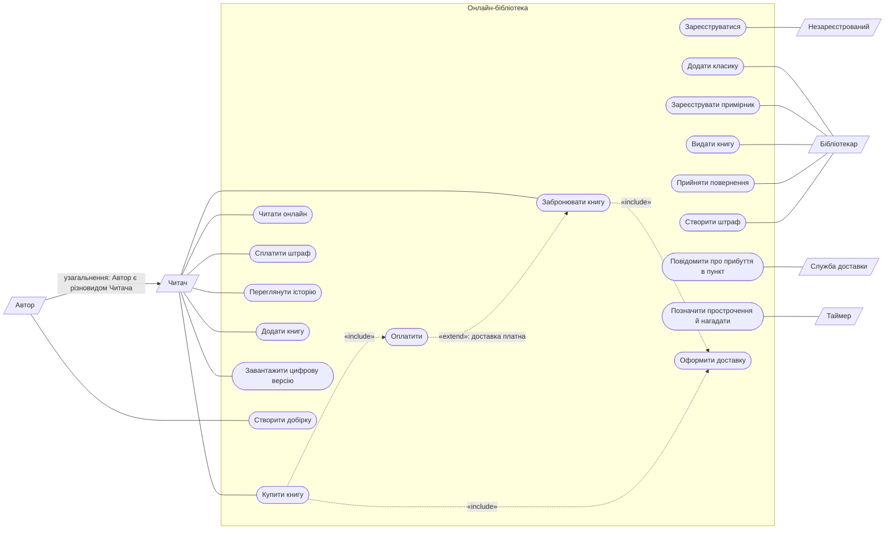

# Spec: Вимоги та Use Cases для онлайн-бібліотеки

Це моя робота до лаби 2. Модель даних я беру з лаби 1 (`lab-1/spec.md`). Тут я описую, що система має вміти, і докладно розбираю один сценарій: «Забронювати книгу».

## 1. Актори і цілі

| Актор | Мета |
|---|---|
| Незареєстрований користувач | Може лише зареєструватися. До решти функцій доступу не має. |
| Читач | Бронює й купує книги, читає онлайн, сплачує штраф, переглядає історію, додає власну книгу й цифрову версію до неї. |
| Автор | Спеціалізація Читача: читач, який уже додав власну книгу. Може все те саме й додатково створює добірку. |
| Бібліотекар | Додає класику й ціну, реєструє примірники, видає книги (фіксує отримання читачем), приймає повернення, створює штраф. |
| Служба доставки | Сама повідомляє про прибуття замовлення в пункт видачі. |
| Таймер | Сам ініціює нагадування читачу про прострочену бронь (раз на добу). |

**Не актори:**
- платіжний шлюз (оплата синхронна, це деталь реалізації);
- адміністратор (його немає);
- «система» (це сама система, а не зовнішня сторона).

## 2. UC-діаграма



**Зв'язки між UC:**
- `include`: «Оформити доставку» з UC «Забронювати книгу» і «Купити книгу» (самовивіз теж доставка).
- `include`: «Оплатити» з UC «Купити книгу».
- `extend`: «Оплатити» до UC «Забронювати книгу», умова: доставка платна.
- Узагальнення: Читач є загальним актором, Автор його спеціалізація (успадковує всі UC Читача).

**Не UC (це дії системи):**
- перевірка ліміту, штрафу, прострочення;
- перереєстрація примірника;
- особистий кабінет (це вікно, а не сценарій).

## 3. Обраний UC: «Забронювати книгу»

Книгу видає бібліотекар (UC «Видати книгу»), і саме він фіксує, що читач її отримав. Окремої кнопки «я отримав» у читача немає. Коли читач оформлює бронь, `start_date` це день оформлення, а `end_date` це `start_date` плюс обраний термін у днях. Коли бібліотекар видає книгу, обидві дати рахуються заново від дня видачі, а термін лишається тим самим. Це потрібно через повільну доставку, яка йде 30-60 днів: до видачі `end_date` лише приблизна, тому прострочення починається тільки після видачі. День видачі зберігається в `received_at` доставки, а прибуття в пункт модель не зберігає (розбіжність №2 в аудиті).

Сценарії Gherkin:

```gherkin
# language: uk
Функціонал: Забронювати книгу

  Передумова:
    Дано читач авторизований

  Правило: Бронь створюється, коли немає перешкод

    Передумова:
      Дано у читача немає несплачених штрафів і прострочених броней
      І читач має менше 3 активних броней

    Сценарій: 1. Успішна бронь із самовивозом
      Дано примірник вільний і числиться в бібліотеці Б
      Коли читач обирає цей примірник, термін 60 днів і самовивіз із бібліотеки Б
      Тоді система створює бронь із терміном 60 днів
      І створює доставку self_pickup із вартістю 0 і швидкістю 0 у пункт видачі «бібліотека Б»
      І платіж не створюється

    Сценарій: 2. Успішна бронь із прискореною доставкою й оплатою (extend «Оплатити»)
      Дано примірник вільний і числиться в бібліотеці А
      І прискорена доставка в бібліотеку Б платна (вартість більше 0)
      Коли читач обирає прискорену доставку в бібліотеку Б
      І оплата проходить
      Тоді система створює бронь
      І створює доставку express у пункт видачі «бібліотека Б»
      І створює платіж на суму вартості доставки

    Сценарій: 2а. Гілка сценарію 2: оплата не пройшла
      Дано примірник вільний і числиться в бібліотеці А
      І прискорена доставка в бібліотеку Б платна (вартість більше 0)
      Коли читач обирає прискорену доставку в бібліотеку Б
      І оплата не проходить
      Тоді система створює бронь
      І створює доставку slow у пункт видачі «бібліотека Б» із вартістю 0
      І платіж не створюється

  Правило: Бронь відхиляється, коли умови не виконані

    Сценарій: 3. Відмова: уже 3 активні броні
      Дано читач має 3 активні броні (returned_at порожнє)
      І у читача немає несплачених штрафів і прострочених броней
      І примірник вільний і числиться в бібліотеці
      Коли читач намагається забронювати цей примірник
      Тоді система відхиляє бронь і показує причину «ліміт 3 броні»
      І бронь і доставка не створюються

    Структура сценарію: 4. Відмова: порушено іншу умову бронювання
      Дано читач має менше 3 активних броней
      І примірник вільний і числиться в бібліотеці
      І <ситуація>
      І, крім цієї ситуації, перешкод для бронювання немає
      Коли читач намагається забронювати цей примірник
      Тоді система відхиляє бронь і показує причину <причина>
      І бронь і доставка не створюються

      Приклади:
        | ситуація                                                                          | причина                   |
        | у читача є несплачений штраф (is_paid = false)                                    | «є несплачений штраф»     |
        | у читача є прострочена бронь (книгу видано, end_date минула, returned_at порожнє) | «є прострочена бронь»     |
        | у читача вже є активна бронь на примірник цієї книги                              | «на цю книгу вже є бронь» |
        | читач обрав термін 200 днів                                                       | «термін понад 183 дні»    |
```

Сценарій 1 спирається на критерій 10 spec лаби 1: самовивіз лише з бібліотеки, де числиться примірник.

## 4. EARS (лише для сценаріїв вище)

Кожна вимога має одну реакцію системи. Таймер і служба доставки можуть бути лише тригером, субʼєктом завжди є система.

- **EARS-1.** Якщо читач має 3 активні броні, то система повинна відхилити нову бронь. Бронь активна, поки `returned_at` порожнє.
- **EARS-2.** Якщо у читача є несплачений штраф, то система повинна відхилити нову бронь.
- **EARS-3.** Якщо у читача є прострочена бронь (книгу видано, тобто `received_at` доставки цієї броні заповнене, `end_date` минула, `returned_at` порожнє), то система повинна відхилити нову бронь.
- **EARS-4.** Якщо читач має активну бронь на примірник цієї книги, то система повинна відхилити нову бронь на цю книгу.
- **EARS-5.** Система повинна дозволяти бронювання лише вільного примірника, тобто такого, що числиться в бібліотеці й не має активної броні.
- **EARS-6.** Якщо обраний термін броні перевищує 183 дні, то система повинна відхилити бронь.
- **EARS-7.** Система повинна доставляти бронь лише в пункт видачі типу library.
- **EARS-8.** Коли читач обирає самовивіз, система повинна дозволити його лише з бібліотеки, де числиться примірник.
- **EARS-9.** Коли читач обирає самовивіз, система повинна встановити вартість доставки 0.
- **EARS-10.** Коли читач обирає прискорену доставку, система повинна вимагати оплату її вартості перед створенням броні.
- **EARS-11.** Якщо оплата прискореної доставки не пройшла, то система повинна змінити доставку на slow у той самий пункт видачі з вартістю 0.
- **EARS-12.** Коли служба доставки повідомляє про прибуття в пункт типу library, система повинна змінити `library_id` примірника на цю бібліотеку.
- **EARS-13.** Коли бібліотекар позначає видачу книги, система повинна встановити `start_date` рівним даті видачі й перерахувати `end_date` як дату видачі плюс кількість днів між `start_date` і `end_date`, встановленими при оформленні.
- **EARS-13а.** Коли бібліотекар позначає видачу книги, система повинна записати дату видачі в `received_at` доставки цієї броні.
- **EARS-14.** Система повинна вважати бронь простроченою, якщо `received_at` доставки цієї броні заповнене, `end_date` минула, а `returned_at` порожнє. Окремого поля для цього в `Reservation` немає, прострочення обчислюється.
- **EARS-15.** Поки бронь прострочена, система повинна за сигналом таймера нагадувати читачу про повернення один раз на добу повідомленням у застосунку.
- **EARS-16.** Коли система відхиляє бронь, вона повинна показати читачу причину відмови з фіксованого переліку: «ліміт 3 броні», «є несплачений штраф», «є прострочена бронь», «на цю книгу вже є бронь», «термін понад 183 дні». Якщо порушено кілька умов одразу, система показує першу за порядком у цьому переліку.

## 5. NFR

| Категорія | Вимога |
|---|---|
| Користувачі | Ролі: читач, автор, бібліотекар. Читачі й автори разом: до 500 одночасних активних сесій. Бібліотекарі: до 20 одночасно. |
| Пристрої й браузери | Веб-застосунок. Chrome, Firefox, Edge, Safari: дві останні версії. Мобільні: Android 12+, iOS 16+. Адаптивний інтерфейс від ширини 360 px. |
| Навантаження | До 2000 броней на добу. |
| Час відповіді | Підтвердження або відхилення броні: до 2 с у 95% запитів. Сценарій з оплатою (синхронною): до 10 с. |
| Безпека | Паролі зберігаються лише як хеш із сіллю (bcrypt, cost не менше 10). Сесія завершується через 30 хв неактивності, максимум 12 год. Лише HTTPS (TLS 1.2+). Читач бачить тільки власні броні, купівлі, штрафи й прогрес читання. |
| Мова інтерфейсу | Українська. Інші мови поза обсягом. |
| Доступність | 99% за календарний місяць із 30 діб (допустимий простій близько 7 годин). |

## 6. Поза обсягом

- **Групи книг** (`ReaderGroup`, зв'язок `groups` з `Book`) і **збереження колекцій читачем** (`saves`) є в ER-моделі з лабораторної 1, але use case для них у цій роботі немає. Із функцій навколо колекцій розглянуто лише створення добірки автором. Із моделі вони не прибрані, бо ER-модель є результатом попередньої лабораторної. Тому в матриці трасування вони не мають вимог і сценаріїв, і це свідоме рішення.
- Адміністратор і модерація.
- Сценарій «замовлення вільного примірника з іншої бібліотеки» окремо не розписаний: він входить у сценарій 2 (доставка в бібліотеку читача).
- Платіжний шлюз як окрема система.
- **Невитребувана бронь:** примірник приїхав у пункт, а читач не прийшов. Строк зберігання в пункті й автоскасування броні не описані, бо вглиб розписано оформлення броні, а не її життя після прибуття. Наслідок: така бронь лишається активною, займає місце в ліміті й блокує примірник, доки бібліотекар не позначить повернення.
- **Видача в пунктах типу shop і post.** У них немає бібліотекаря, тому в цій роботі бронь доставляється лише в пункт типу library (EARS-7). Видача в магазині й на пошті стосується лише купівлі й не розглядається.
- Технологічний стек: умовою не заданий, тому не фіксується й у NFR не входить.

## 7. Матриця трасування

Матрицю «вимога ↔ сценарій ↔ UC» винесено в окремий файл: [traceability.md](traceability.md).

## 8. Аудит

Аудит (розбіжності з моделлю лаби 1, двозначності EARS і NFR, перевірка include, extend й узагальнення) винесено в окремий файл: [audit.md](audit.md).
