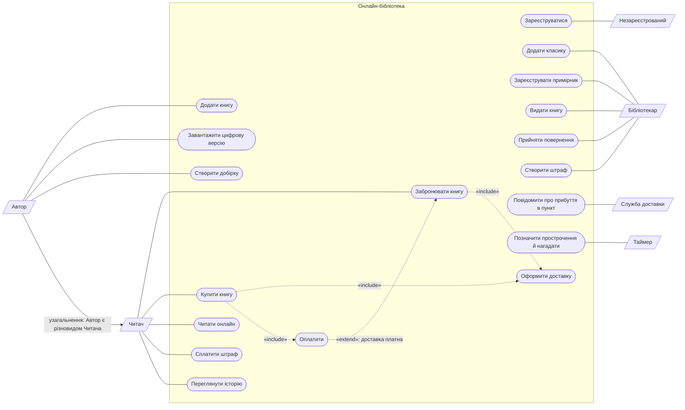

# Spec: Вимоги та Use Cases для онлайн-бібліотеки

Це моя робота до лаби 2. Модель даних я беру з лаби 1 (`lab-1/spec.md`). Тут я описую, що система має вміти, і докладно розбираю один сценарій: «Забронювати книгу».

## 1. Актори і цілі

| Актор | Мета |
|---|---|
| Незареєстрований користувач | Може лише зареєструватися. До решти функцій доступу не має. |
| Читач | Бронює й купує книги, читає онлайн, сплачує штраф, переглядає історію. |
| Автор | Спеціалізація Читача: може все те саме й додатково додає книгу й цифрову версію, створює добірку. |
| Бібліотекар | Додає класику й ціну, реєструє примірники, видає книги (фіксує отримання читачем), приймає повернення, створює штраф. |
| Служба доставки | Сама повідомляє про прибуття замовлення в пункт видачі. |
| Таймер | Сам ініціює перевірку термінів: визначає прострочення броні й запускає нагадування читачу. |

**Не актори:**
- платіжний шлюз (оплата синхронна, це деталь реалізації);
- адміністратор (його немає);
- «система» (це сама система, а не зовнішня сторона).

## 2. UC-діаграма



**Зв'язки між UC:**
- `include`: «Оформити доставку» з UC «Забронювати книгу» і «Купити книгу» (самовивіз теж доставка).
- `include`: «Оплатити» з UC «Купити книгу».
- `extend`: «Оплатити» до UC «Забронювати книгу», умова: доставка платна.
- Узагальнення: Читач є загальним актором, Автор його спеціалізація (успадковує всі UC Читача).

**Не UC (це дії системи):**
- перевірка ліміту, штрафу, прострочення;
- перереєстрація примірника;
- особистий кабінет (це вікно, а не сценарій).

## 3. Обраний UC: «Забронювати книгу»

Книгу видає бібліотекар (UC «Видати книгу»), і саме він фіксує, що читач її отримав. Окремої кнопки «я отримав» у читача немає. Коли читач оформлює бронь, `start_date` це день оформлення, а `end_date` це `start_date` плюс обраний термін. Коли бібліотекар видає книгу, обидві дати рахуються заново від дня видачі, а термін лишається тим самим. Це потрібно через повільну доставку, яка йде 30-60 днів: до видачі `end_date` лише приблизна, тому прострочення починається тільки після видачі. День видачі зберігається в `received_at` доставки, а прибуття в пункт модель не зберігає (розбіжність №2 в аудиті).

Сценарії Gherkin:

```gherkin
# language: uk
Функціонал: Забронювати книгу

  Передумова:
    Дано читач авторизований

  Правило: Бронь створюється, коли немає перешкод

    Передумова:
      Дано у читача немає несплачених штрафів і прострочених броней
      І читач має менше 3 активних броней

    Сценарій: 1. Успішна бронь із самовивозом
      Дано примірник вільний і числиться в бібліотеці Б
      Коли читач обирає цей примірник, термін 2 місяці й самовивіз із бібліотеки Б
      Тоді система створює бронь із терміном 2 місяці
      І створює доставку self_pickup із вартістю 0 і швидкістю 0 у пункт видачі «бібліотека Б»
      І платіж не створюється

    Сценарій: 2. Успішна бронь із прискореною доставкою й оплатою (extend «Оплатити»)
      Дано примірник вільний і числиться в бібліотеці А
      І прискорена доставка в бібліотеку Б платна (вартість більше 0)
      Коли читач обирає прискорену доставку в бібліотеку Б
      І оплата проходить
      Тоді система створює бронь
      І створює доставку express у пункт видачі «бібліотека Б»
      І створює платіж на суму вартості доставки

    Сценарій: 2а. Гілка сценарію 2: оплата не пройшла
      Дано примірник вільний і числиться в бібліотеці А
      І прискорена доставка в бібліотеку Б платна (вартість більше 0)
      Коли читач обирає прискорену доставку в бібліотеку Б
      І оплата не проходить
      Тоді система створює бронь
      І змінює доставку на slow у пункт видачі «бібліотека Б» із вартістю 0
      І платіж не створюється

  Правило: Бронь відхиляється, коли умови не виконані

    Сценарій: 3. Відмова: уже 3 активні броні
      Дано читач має 3 активні броні (returned_at порожнє)
      І у читача немає несплачених штрафів і прострочених броней
      І примірник вільний і числиться в бібліотеці
      Коли читач намагається забронювати цей примірник
      Тоді система відхиляє бронь і показує причину «ліміт 3 броні»
      І бронь і доставка не створюються

    Структура сценарію: 4. Відмова: порушено іншу умову бронювання
      Дано читач має менше 3 активних броней
      І примірник вільний і числиться в бібліотеці
      І <ситуація>
      Коли читач намагається забронювати цей примірник
      Тоді система відхиляє бронь і показує причину <причина>
      І бронь і доставка не створюються

      Приклади:
        | ситуація                                                            | причина                      |
        | у читача є несплачений штраф (is_paid = false)                      | «є несплачений штраф»        |
        | у читача є прострочена бронь (книгу видано, end_date минула, returned_at порожнє) | «є прострочена бронь»        |
        | читач уже тримає примірник цієї книги (активна бронь на неї)        | «книга вже на руках»         |
        | читач обрав термін 7 місяців                                        | «термін понад 6 місяців»     |
```

Сценарій 1 спирається на критерій 10 spec лаби 1: самовивіз лише з бібліотеки, де числиться примірник.

## 4. EARS (лише для сценаріїв вище)

Кожна вимога має одну реакцію системи. Таймер і служба доставки можуть бути лише тригером, субʼєктом завжди є система.

- **EARS-1.** Якщо читач має 3 активні броні, то система повинна відхилити нову бронь. Бронь активна, поки `returned_at` порожнє.
- **EARS-2.** Якщо у читача є несплачений штраф, то система повинна відхилити нову бронь.
- **EARS-3.** Якщо у читача є прострочена бронь (книгу видано, тобто `received_at` заповнене, `end_date` минула, `returned_at` порожнє), то система повинна відхилити нову бронь.
- **EARS-4.** Якщо читач має активну бронь на примірник цієї книги, то система повинна відхилити нову бронь на цю книгу.
- **EARS-5.** Система повинна дозволяти бронювання лише вільного примірника, тобто такого, що числиться в бібліотеці й не має активної броні.
- **EARS-6.** Якщо обраний термін броні перевищує 6 календарних місяців, то система повинна відхилити бронь.
- **EARS-7.** Система повинна доставляти бронь лише в пункт видачі типу library.
- **EARS-8.** Коли читач обирає самовивіз, система повинна дозволити його лише з бібліотеки, де числиться примірник.
- **EARS-9.** Коли читач обирає самовивіз, система повинна встановити вартість доставки 0.
- **EARS-10.** Коли читач обирає прискорену доставку, система повинна вимагати оплату її вартості перед створенням броні.
- **EARS-11.** Якщо оплата прискореної доставки не пройшла, то система повинна змінити доставку на slow у той самий пункт видачі з вартістю 0.
- **EARS-12.** Коли служба доставки повідомляє про прибуття в пункт типу library, система повинна змінити `library_id` примірника на цю бібліотеку.
- **EARS-13.** Коли бібліотекар позначає видачу книги, система повинна встановити `start_date` рівним даті видачі й перерахувати `end_date`, зберігши обраний термін.
- **EARS-14.** Коли таймер фіксує, що книгу видано (`received_at` заповнене), `end_date` минула, а `returned_at` порожнє, система повинна вважати бронь простроченою. Прострочення обчислюється з `received_at`, `end_date` і `returned_at`, окремого поля в `Reservation` для нього немає. До видачі бронь простроченою не стає.
- **EARS-15.** Поки бронь прострочена, система повинна нагадувати читачу про повернення один раз на добу повідомленням у застосунку.
- **EARS-16.** Коли система відхиляє бронь, вона повинна показати читачу причину відмови з фіксованого переліку: «ліміт 3 броні», «є несплачений штраф», «є прострочена бронь», «книга вже на руках», «термін понад 6 місяців».

## 5. NFR

| Категорія | Вимога |
|---|---|
| Користувачі | Ролі: читач, автор, бібліотекар. Читачі й автори разом: до 500 одночасних активних сесій. Бібліотекарі: до 20 одночасно. |
| Пристрої й браузери | Веб-застосунок. Chrome, Firefox, Edge, Safari: дві останні версії. Мобільні: Android 12+, iOS 16+. Адаптивний інтерфейс від ширини 360 px. |
| Навантаження | До 2000 броней на добу. |
| Час відповіді | Підтвердження або відхилення броні: до 2 с у 95% запитів. Сценарій з оплатою (синхронною): до 10 с. |
| Безпека | Паролі зберігаються лише як хеш із сіллю (bcrypt, cost не менше 10). Сесія завершується через 30 хв неактивності, максимум 12 год. Лише HTTPS (TLS 1.2+). Читач бачить тільки власні броні, купівлі, штрафи й прогрес читання. |
| Мова інтерфейсу | Українська. Інші мови поза обсягом. |
| Доступність | 99% за календарний місяць із 30 діб (допустимий простій близько 7 годин). |

## 6. Поза обсягом

- **Групи книг** (`ReaderGroup`, зв'язок `groups` з `Book`) і **збереження колекцій читачем** (`saves`) є в ER-моделі з лабораторної 1, але use case для них у цій роботі немає. Із функцій навколо колекцій розглянуто лише створення добірки автором. Із моделі вони не прибрані, бо ER-модель є результатом попередньої лабораторної. Тому в матриці трасування вони не мають вимог і сценаріїв, і це свідоме рішення.
- Адміністратор і модерація.
- Сценарій «замовлення вільного примірника з іншої бібліотеки» окремо не розписаний: він входить у сценарій 2 (доставка в бібліотеку читача).
- Платіжний шлюз як окрема система.
- **Невитребувана бронь:** примірник приїхав у пункт, а читач не прийшов. Строк зберігання в пункті й автоскасування броні не описані, бо вглиб розписано оформлення броні, а не її життя після прибуття. Наслідок: така бронь лишається активною, займає місце в ліміті й блокує примірник, доки бібліотекар не позначить повернення.
- **Видача в пунктах типу shop і post.** У них немає бібліотекаря, тому в цій роботі бронь доставляється лише в пункт типу library (EARS-7). Видача в магазині й на пошті стосується лише купівлі й не розглядається.
- Технологічний стек: умовою не заданий, тому не фіксується й у NFR не входить.

## 7. Матриця трасування

Зв'язок «багато до багатьох»: одне правило може покривати кілька сценаріїв, а один сценарій перевіряє кілька правил.

| EARS | Сценарії | UC | Покриття |
|---|---|---|---|
| EARS-1 (ліміт 3) | 3 | Забронювати книгу | покрито |
| EARS-2 (штраф) | 4 (рядок «штраф») | Забронювати книгу | покрито |
| EARS-3 (прострочення) | 4 (рядок «прострочена бронь») | Забронювати книгу | покрито |
| EARS-4 (книга вже на руках) | 4 (рядок «книга на руках») | Забронювати книгу | покрито |
| EARS-5 (вільний примірник) | 1, 2, 2а | Забронювати книгу | частково: перевіряється лише позитивний випадок, відмови для зайнятого примірника немає |
| EARS-6 (термін до 6 місяців) | 4 (рядок «7 місяців»); позитивний випадок у 1 | Забронювати книгу | покрито |
| EARS-7 (бронь доставляється лише в бібліотеку) | 1, 2, 2а | Забронювати книгу, Оформити доставку | частково: перевіряється лише позитивний випадок, відмови для пункту типу shop чи post немає |
| EARS-8 (самовивіз лише з бібліотеки примірника) | 1 | Забронювати книгу, Оформити доставку | частково: перевіряється лише дозволений самовивіз, відмови для чужої бібліотеки немає |
| EARS-9 (самовивіз: вартість 0) | 1 | Забронювати книгу, Оформити доставку | покрито |
| EARS-10 (оплата прискореної) | 2 | Забронювати книгу, Оплатити (extend) | покрито |
| EARS-11 (оплата не пройшла) | 2а | Забронювати книгу, Оплатити (extend) | покрито |
| EARS-12 (перереєстрація примірника) | немає | Повідомити про прибуття в пункт | не покрито: сценарії описують оформлення броні, а не прибуття в пункт |
| EARS-13 (старт терміну при видачі) | немає | Видати книгу | не покрито: те саме, видача поза обраними сценаріями |
| EARS-14 (вважати бронь простроченою) | немає | Позначити прострочення й нагадати | не покрито: сценарій 4 лише припускає стан «прострочена бронь», але не перевіряє його виникнення |
| EARS-15 (нагадування раз на добу) | немає | Позначити прострочення й нагадати | не покрито: причина та сама |
| EARS-16 (причина відмови) | 3, 4 | Забронювати книгу | покрито |

**UC без сценаріїв:** усі, крім «Забронювати книгу» (Купити книгу, Читати онлайн, Сплатити штраф, Переглянути історію, Додати книгу, Завантажити цифрову версію, Створити добірку, Додати класику, Зареєструвати примірник, Видати книгу, Прийняти повернення, Створити штраф, Зареєструватися, Повідомити про прибуття, Позначити прострочення й нагадати). Причина: вглиб розписано один UC.

## 8. Аудит

### 8.1. Розбіжності з моделлю лаби 1 (три головні й одна додаткова)

1. **Бібліотекар не пов'язаний із бібліотекою.** У `User` і в `Library` немає такого зв'язку, тому модель не каже, у якій бібліотеці бібліотекар діє. Через це вона не заважає бібліотекарю однієї бібліотеки позначити видачу в іншій.
2. **У `Delivery` одне `received_at` на дві події:** прибуття в пункт і видача читачу. У цій роботі прийнято, що `received_at` фіксує видачу читачу, а прибуття в пункт не зберігається. До того ж `Reservation.start_date` тепер означає дату видачі читачу, а до видачі містить дату оформлення. Після видачі дата оформлення не зберігається, бо іншого поля з датою в `Reservation` немає. Те саме з перереєстрацією примірника: за критерієм 12 лаби 1 вона відбувається при `received_at`, а тут (EARS-12) при прибутті в пункт, коли `received_at` ще порожнє.
3. **Правила «книга вже на руках, бронь заборонена» немає в критеріях лаби 1.** У цій роботі воно введене як EARS-4.
4. **(Додаткова) «Додати книгу» є в діаграмі лише в Автора.** За критерієм 14 лаби 1 книгу додає будь-який користувач, а запис Author з'являється при першому завантаженні. На діаграмі Читач автором ще не є, тому першу книгу додати нікому.

### 8.2. EARS і NFR на двозначність

| Було | Проблема | Як виправлено |
|---|---|---|
| «Дозволити й встановити вартість 0», «вимагати оплату й змінити на стандартну» в одній вимозі | дві реакції, не тестуються окремо | розбито на EARS-8/9 і EARS-10/11 |
| «Коли читач бронює примірник, система повинна дозволити…» | немає тригера, це постійне обмеження | EARS-5 переписано як ubiquitous без «Коли» |
| «Таймер повинен позначити…» | субʼєкт EARS завжди система | EARS-14: «Коли таймер фіксує…, система повинна…» |
| «Позначити бронь простроченою» | незрозуміло, чи відмітка зберігається, а поля статусу в `Reservation` немає | EARS-14: прострочення обчислюється з трьох полів і окремо не зберігається |
| «6 місяців» | календарні місяці чи 180 днів, від чого | EARS-6: календарні місяці, перевіряється довжина обраного терміну |
| Пункт видачі броні не обмежений типом | у магазині й на пошті немає бібліотекаря, який фіксує видачу, тому бронь там не можна отримати | EARS-7: бронь доставляється лише в пункт типу library |
| «Відхилити й пояснити причину» | «пояснити» неможливо перевірити | EARS-16: фіксований перелік текстів причин |
| «Позначити прострочення / нагадати» | дві цілі, частота нагадувань не задана | розділено на EARS-14 і EARS-15, нагадування раз на добу |
| Прострочена бронь без уточнення, від якого моменту | при повільній доставці `end_date` минає ще до видачі, і читача блокує прострочення книги, якої він не отримав | EARS-3 і EARS-14: прострочення лише після видачі (`received_at` заповнене) |
| NFR «500 одночасних користувачів» | незрозуміло, що вважати користувачем | уточнено: активні сесії |
| NFR «99%» | період і база розрахунку не задані | уточнено: календарний місяць із 30 діб |

### 8.3. Перевірка include / extend / узагальнення

- `include` «Оформити доставку» з «Забронювати книгу» і «Купити книгу»: коректно, доставка є в кожної броні й купівлі завжди.
- `include` «Оплатити» з «Купити книгу»: коректно, купівля без оплати неможлива.
- `extend` «Оплатити» до «Забронювати книгу»: коректно, бронь безкоштовна, оплата лише за платну доставку (умова в самому звʼязку).
- Узагальнення: Читач є загальним актором, Автор його спеціалізація. Формулювання «Автор узагальнює Читача» було б зворотним.
